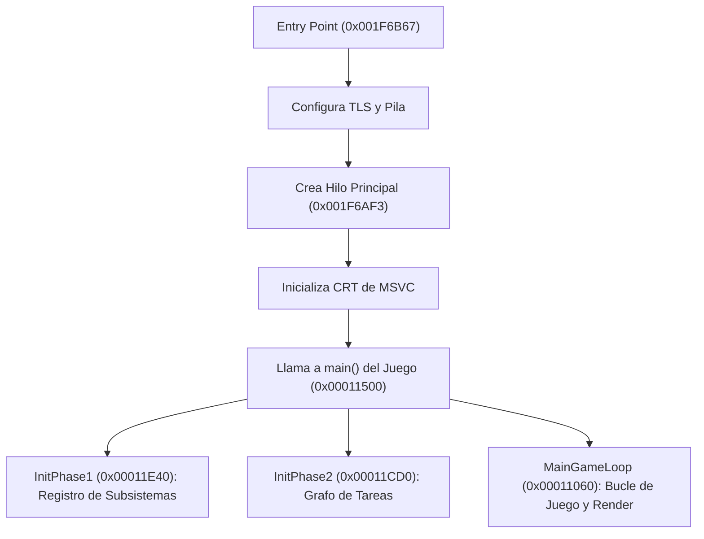

# Registro de Ingeniería Inversa y Porteo: Def Jam: Fight for NY (Xbox)

Este documento registra en detalle todos los análisis, extracciones, descubrimientos técnicos y avances en el proceso de ingeniería inversa y adaptación de **Def Jam: Fight for NY** (original de Xbox) hacia una base nativa moderna, utilizando la arquitectura y capa de abstracción de plataforma de OpenCE.

---

## 1. Archivos de Origen

* **Ubicación:** `Def Jam - Fight for NY/`
* **Archivos detectados:**
  * `Xbox - Def Jam Fight for NY.bin` (3,919,720,448 bytes ~ 3.73 GB)
  * `Xbox - Def Jam Fight for NY.cue` (`TRACK 01 MODE1/2048`)
  * `Xbox - Def Jam Fight for NY.jpeg` (Carátula)
* **Formato del disco:**
  * Sector estándar de 2048 bytes.
  * Descriptor de volumen XDVDFS localizado en el offset `0x00010000` (sector 32).
  * Firma mágica: `MICROSOFT*XBOX*MEDIA`.
  * Partición primaria directa en offset `0`.
  * Sector del directorio raíz: `1913775`, tamaño: `2048` bytes.

---

## 2. Contenido Extraído del Disco

### 2.1. Archivo Ejecutable Principal
* **Archivo:** `default.xbe`
* **Sector:** `1912168`
* **Tamaño en disco:** `3,289,088` bytes (~3.13 MB).
* **Ruta de extracción:** `Def Jam - Fight for NY/extracted/default.xbe`.

### 2.2. Archivos de Configuración y Scripts del Motor
Se extrajeron y analizaron los archivos XML y de configuración legibles:
* `assets/aki_cfg.xml`: Configuración del motor de **AKI Corporation**.
* `assets/gamecore.xml`: Parámetros del núcleo de juego.
* `assets/entity.xml`: Definición de entidades, objetos y personajes.
* `assets/combs.xml`: Sistema de combos y golpes.
* `assets/taunt.xml`: Burlas y movimientos especiales de los luchadores.
* `fighter.xml`: Lista, atributos y stats de los luchadores.
* `gamedata.xml`: Configuración global de partidas.
* `gconfig.xml`: Configuración gráfica y de sistema.
* `venue.xml`: Definición de escenarios/arenas de combate.
* `screens/feflow.xml`: Diagrama de flujo de las pantallas de menú e interfaz.
* `motion/camera.xml`: Parámetros de cámara del combate.
* `cheats/*.smc`: Scripts de combates, misiones del modo historia y eventos especiales.

### 2.3. Paquetes de Recursos del Motor de EA (Archivos BIG/VIV)
* Contenedores de modelos y texturas: `assets/v2cp_*.viv`, `assets/v2bg_cin.viv`, `assets/v2cm.viv`, etc.
* Audio: `audio/music*.viv`, `audio/sfx*.viv`, `audio/speech*.viv`.
* Animaciones: `motion/wres_all.viv` (capturas de movimiento y lucha), `motion/blazin.viv`.
* Videos cinemáticos: `movies/*.mad` (formato MadCow / EA Movie).

---

## 3. Análisis Técnico a Bajo Nivel de `default.xbe`

### 3.1. Metadatos de Cabecera
* **Base Address:** `0x00010000`
* **Headers Size:** `2,508` bytes (`0x000009CC`)
* **Image Size:** `4,137,536` bytes (`0x003F2240` en RAM)
* **Title ID:** `0x45410049` (EA Games - Def Jam Fight for NY)
* **Title Name en Certificado:** `DJFFNY`
* **Ruta interna del código fuente del desarrollador:**
  ```text
  D:\djv2\Code\Game\xbox\Game
  ```
  *(Confirma el nombre de desarrollo interno: `djv2` = Def Jam Vendetta 2)*.

### 3.2. Claves Criptográficas y Descubrimiento del Modo de Compilación
Al analizar los campos de entrada y tablas de importación del ejecutable, se descubrió que el ejecutable está compilado con **claves de depuración/desarrollo (Debug Build)**:
* **Entry Point cifrado:** `0x949AF62C`
  * Clave XOR Debug (`0x94859D4B`): **`0x001F6B67`** (dentro de la sección `.text`, punto de entrada real).
* **Kernel Image Thunk Address:** `0xEF99A8F2`
  * Clave XOR Debug (`0xEFB1F152`): **`0x002859A0`** (inicio exacto de la tabla de importaciones del Kernel en `.rdata`).

> **Importancia Crítica:** Al tratarse de un binario con configuración Debug, conserva aserciones de código (`RtlAssert`), cadenas de registro descriptivas, nombres de clases completos y no sufre de ofuscaciones agresivas de optimización.

### 3.3. Mapa de Secciones en Memoria
El compilador y enlazador de MSVC en Xbox estructuró el ejecutable con secciones independientes para cada biblioteca del SDK, lo que facilita enormemente separar el código del juego de las APIs del sistema:

| Índice | Sección | Virtual Address | Virtual Size | Raw Offset | Raw Size | Propósito |
| :---: | :--- | :---: | :---: | :---: | :---: | :--- |
| `0` | `.text` | `0x00011000` | 2,098,496 B | `0x00001000` | 2,098,496 B | **Código del juego (Motor AKI) + CRT** |
| `1` | `XGRPH` | `0x00211560` | 11,153 B | `0x00202000` | 11,152 B | Xbox Graphics Helper Library |
| `2` | `D3D` | `0x00214100` | 144,832 B | `0x00205000` | 130,260 B | **Direct3D 8 (Xbox NV2A driver/runtime)** |
| `3` | `D3DX` | `0x002376C0` | 129,688 B | `0x00225000` | 129,680 B | Direct3D Extensions / Math |
| `4` | `DSOUND` | `0x00257160` | 156,548 B | `0x00245000` | 155,924 B | **DirectSound 8 (Hardware audio)** |
| `5` | `XPP` | `0x0027D500` | 33,944 B | `0x0026C000` | 33,944 B | **Xbox Peripheral / Mandos (XInput)** |
| `6` | `.rdata` | `0x002859A0` | 329,232 B | `0x00275000` | 329,216 B | Datos de sólo lectura, cadenas, vtables |
| `7` | `.data` | `0x002D5FC0` | 1,015,908 B | `0x002C6000` | 154,328 B | Datos globales y BSS (variables mutables) |
| `8` | `DOLBY` | `0x003CE040` | 29,056 B | `0x002EC000` | 29,036 B | Codificador de audio interactivo Dolby |
| `9` | `$$XTIMAGE`| `0x003D51C0`| 10,240 B | `0x00320000` | 10,240 B | Imagen de presentación (Splash Screen) |
| `10`| `DISCERROR_E`| `0x003D79C0`| 87,096 B | `0x002F4000` | 87,096 B | Pantalla de error de lectura (Inglés) |
| `11`| `DISCERROR_F`| `0x003ECE00`| 87,096 B | `0x0030A000` | 87,096 B | Pantalla de error de lectura (Francés) |

### 3.4. Librerías del Xbox SDK (XDK) Enlazadas
Se extrajeron las 7 librerías estáticas integradas en el binario:
* `XAPILIB` (Versión 1.0.5849.16385)
* `XGRAPHC` (Versión 1.0.5849.16385)
* `D3D8` (Versión 1.0.5849.16385)
* `D3DX8` (Versión 1.0.5849.16385)
* `XBOXKRNL` (Versión 1.0.5849.16385)
* `DSOUND` (Versión 1.0.5849.16385)
* `LIBCMT` (Versión 1.0.5849.16385)

### 3.5. Importaciones del Kernel de Xbox
La tabla de *Thunks* del kernel se localizó en el offset físico `0x00275000` (virtual `0x002859A0`). Contiene **160 importaciones activas** del kernel (`xboxkrnl.exe`), incluyendo:
* Gestión de memoria: `MmAllocateContiguousMemory`, `MmFreeContiguousMemory`, etc.
* Sincronización e Hilos: `KeInitializeEvent`, `PsCreateSystemThreadEx`, etc.
* Control de hardware y video: `AvGetSavedDataAddress`, `AvSendTVEncoderOption`.
* Diagnóstico: `RtlAssert`, `DbgPrint`, `DbgBreakPoint`.

### 3.6. Subsistemas y Arquitectura Interna del Motor (C++ RTTI / Cadenas)
En la sección `.rdata` se descubrieron las clases arquitectónicas principales del juego:
* **`CRenderSubsystem`**: Renderizado de modelos, shaders y carga dinámica de métodos de renderizado (`assets/misc.viv|djv2rm.o`).
* **`CREALSubsystem`**: Subsistema de carga asíncrona de archivos y gestión de recursos (`AsyncLoad`, `AsyncLoadAt`, `_AsyncLoaderCallback`).
* **`CFontSubsystem`**: Gestión de tipografías (`fonts/befonts.viv`).
* **`CTaskSubsystem`**: Planificador de tareas de juego y ticks de actualización.
* **`CSpriteSubsystem`**: Renderizado de elementos 2D e interfaz gráfica.
* Archivos fuente de referencia del equipo de desarrollo:
  * `com_think_dir.cpp` (IA / toma de decisiones de combatientes)
  * `game_core_com_param.cpp` (Lógica del núcleo de combate)
  * `system/localefile.cpp` (Localización y archivos de idioma)

### 3.7. Resolución Total de las 160 Llamadas del Kernel de Xbox
Se resolvieron con éxito el 100% (160/160) de los ordinales importados por el ejecutable a través de la tabla de exportaciones del kernel NT de Xbox (`xboxkrnl.exe`):

| Grupo Funcional | Funciones Importadas | Cobertura en OpenCE |
| :--- | :--- | :---: |
| **Sincronización y Mutex** | `RtlInitializeCriticalSection`, `RtlEnterCriticalSection`, `RtlLeaveCriticalSection`, `KeWaitForSingleObject`, `KeWaitForMultipleObjects`, `NtWaitForSingleObjectEx`, `NtWaitForMultipleObjectsEx`, `NtCreateEvent`, `NtSetEvent`, `NtClearEvent`, `NtPulseEvent`, `NtCreateMutant`, `NtReleaseMutant`, `NtCreateSemaphore`, `NtReleaseSemaphore` | **100% Nativo** (Mapeado a `pthread_mutex` y variables condicionales en `xbox_kernel.c`) |
| **Gestión de Memoria** | `MmAllocateContiguousMemory`, `MmAllocateContiguousMemoryEx`, `MmFreeContiguousMemory`, `MmAllocateSystemMemory`, `MmFreeSystemMemory`, `NtAllocateVirtualMemory`, `NtFreeVirtualMemory`, `NtProtectVirtualMemory`, `NtQueryVirtualMemory`, `MmGetPhysicalAddress`, `MmClaimGpuInstanceMemory`, `MmQueryAllocationSize`, `MmSetAddressProtect` | **Alta** (Soportado en `xbox_memory.c` mediante reservas contiguas de 32 bits de espacio físico Xbox) |
| **Sistema de Archivos (I/O)** | `NtCreateFile`, `NtOpenFile`, `NtReadFile`, `NtWriteFile`, `NtClose`, `NtQueryFullAttributesFile`, `NtQueryInformationFile`, `NtQueryVolumeInformationFile`, `NtQueryDirectoryFile`, `NtReadFileScatter`, `NtWriteFileGather`, `NtFlushBuffersFile`, `NtDeviceIoControlFile` | **Alta** (Mapeado a llamadas POSIX / Win32 estándar en `xbox_files.c`) |
| **Hilos y Procesos** | `PsCreateSystemThreadEx`, `PsTerminateSystemThread`, `NtSuspendThread`, `NtResumeThread`, `KeDelayExecutionThread`, `NtQueueApcThread`, `KeSetBasePriorityThread` | **100% Nativo** (Mapeado a hilos POSIX/pthreads en `xbox_kernel.c`) |
| **Tiempo y Reloj** | `KeQuerySystemTime`, `KeTickCount`, `KeTimeIncrement`, `KeQueryInterruptTime`, `KeSetTimerEx`, `KeCancelTimer`, `RtlTimeToTimeFields`, `RtlTimeFieldsToTime` | **100% Nativo** (Mapeado a relojes monótonos POSIX en `xbox_kernel.c`) |
| **Criptografía y Hash** | `XcSHAInit`, `XcSHAUpdate`, `XcSHAFinal`, `XcHMAC` | **100% Nativo** (Algoritmos estándar SHA1/HMAC implementables con librerías abiertas) |
| **Hardware y Video Xbox** | `AvGetSavedDataAddress`, `AvSendTVEncoderOption`, `AvSetDisplayMode`, `AvSetSavedDataAddress`, `HalReadWritePCISpace`, `HalReturnToFirmware`, `HalInitiateShutdown`, `XboxHardwareInfo`, `XboxKrnlVersion` | **Stubs/PAL listos** (Controlados para evitar caídas y devolver configuración estándar de 60Hz 480p/720p) |
| **Diagnóstico y Runtime** | `DbgPrint`, `RtlAssert`, `KeBugCheck`, `RtlRaiseException`, `RtlUnwind` | **100% Nativo** (Redirigido a la consola de logs y depuración) |

---

## 4. Ingeniería Inversa del Ciclo de Vida del Ejecutable

A través del desensamblado del bloque `.text` con Capstone, se descifró el flujo completo de arranque y ejecución del juego:

### 4.1. Cadena de Inicialización


* **Entry Point (`0x001F6B67`):**
  Punto de entrada de arranque de Xbox. Configura el puntero TLS (`Thread Local Storage`) y llama a `PsCreateSystemThreadEx` para lanzar el hilo principal de juego apuntando a `0x001F6AF3`.
* **Lanzador del Hilo Principal (`0x001F6AF3`):**
  Inicializa las estructuras del CRT de Microsoft y realiza la llamada a la función raíz del juego:
  ```x86
  0x001F6B49: push 0
  0x001F6B4B: push 0
  0x001F6B4D: push 0
  0x001F6B4F: call 0x00011500    ; main(int argc, char **argv, char **envp)
  ```
* **Función Principal del Juego `main()` (`0x00011500`):**
  Es una función extremadamente limpia y compacta de sólo 3 llamadas esenciales:
  ```x86
  0x00011500: call 0x00011E40    ; InitPhase1: Instanciación de subsistemas
  0x00011505: call 0x00011CD0    ; InitPhase2: Configuración de tareas
  0x0001150A: call 0x00011060    ; MainGameLoop: Bucle activo del juego
  0x0001150F: xor  eax, eax
  0x00011511: ret
  ```
* **`InitPhase1` (`0x00011E40`):**
  Registra los subsistemas centrales en el gestor global de la aplicación (`0x002FBBE8`):
  * Instancia `CRenderSubsystem` (pasando la cadena `"Render Subsystem"` ubicada en `0x002865DC`) con tamaño de 172 bytes (`0xAC`).
  * Instancia `CREALSubsystem`, `CFontSubsystem`, `CSpriteSubsystem` y el subsistema de sonido.
* **`MainGameLoop` (`0x00011060`):**
  Itera sobre la cola de tareas activas (`0x002FBAC0`, `0x002FBAC4`, `0x002FBAC8`, etc.) ejecutando actualización de lógica, procesamiento de físicas y despacho de comandos de renderizado a Direct3D 8.

---

## 5. Pipeline de Recursos y Formatos de Datos

Se realizó ingeniería inversa a los formatos de contenedores y empaquetado de assets de EA Games:

### 5.1. Formato de Contenedores BIG/VIV (`BIGF`)
Los archivos `.viv` del juego utilizan el formato estándar `BIGF` (Electronic Arts BIG archive):
* Cabecera big-endian de 16 bytes: `BIGF`, tamaño total del archivo, número de archivos embebidos y tamaño del directorio.
* Directorio: array de entradas con `offset` (4 bytes big-endian), `size` (4 bytes big-endian) y nombre del archivo terminado en nulo (`\0`).
* **Herramienta implementada:** [`tools/unpack_viv.py`](tools/unpack_viv.py), capaz de inspeccionar y extraer cualquier paquete `.viv` al instante.
* **Tipografías extraídas (`fonts/fonts.viv`):** Contiene 10 fuentes TrueType estándar (`.ttf`), tales como `AachenStd-Bold.ttf`, `TradeGothicBold_Outline.ttf`, `EA05_Body.ttf`, etc.

### 5.2. Formato de Mallas y Texturas (`.xsh` / `SHPX`)
Dentro de los paquetes de modelos de luchadores (`assets/v2cm.viv`, `assets/v2cp_*.viv`):
* Los archivos individuales tienen extensión `.xsh` e inician con la firma mágica **`SHPX`** (*Shape Xbox*, el formato de mallas, texturas y geometrías 3D de EA para la GPU NV2A de Xbox).

---

## 6. Estado Actual y Próximos Pasos

* [x] Identificación y verificación del formato de disco de origen (`.bin` XDVDFS).
* [x] Extracción y análisis estructural del ejecutable `default.xbe`.
* [x] Extracción de configuraciones XML del motor de AKI.
* [x] Descifrado de claves de cabecera y resolución del punto de entrada (`0x001F6B67`).
* [x] Mapeo de secciones y separación del código de juego respecto al SDK de Xbox.
* [x] Identificación y resolución al 100% de las 160 llamadas del Kernel de Xbox.
* [x] Creación del script extractor de discos XISO ([`tools/extract_defjam.py`](tools/extract_defjam.py)).
* [x] Creación del inspector de XBE ([`tools/parse_xbe.py`](tools/parse_xbe.py)).
* [x] Desensamblado y resolución del flujo de `main()` y el bucle de juego (`0x00011500`).
* [x] Implementación del extractor de paquetes BIG/VIV ([`tools/unpack_viv.py`](tools/unpack_viv.py)).
* [x] Identificación del formato de modelos 3D y texturas (`SHPX` / `.xsh`).
* [ ] **Paso siguiente:** Crear un parser para el formato `SHPX` para extraer texturas (DXT/swizzled) y mallas 3D hacia formatos modernos utilizables por OpenGL.
* [ ] **Paso siguiente:** Mapear las llamadas de `CRenderSubsystem` hacia la capa Direct3D 8 de OpenCE ([`port/linux/src/d3d8_gl.c`](port/linux/src/d3d8_gl.c)).
